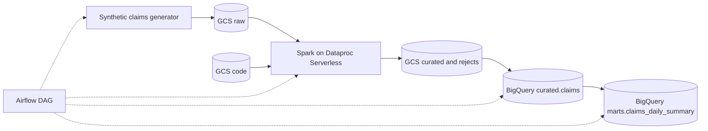

# gcp-data-platform-reference

> A small, runnable reference for a batch data platform on GCP: Terraform, Airflow, Spark on Dataproc Serverless and BigQuery, with idempotent loads, data quality gates and written design decisions.

[](https://github.com/harikalyan-nagisetty/gcp-data-platform-reference/actions/workflows/ci.yml)


> **Data note:** Everything here runs on randomly generated, synthetic data. There is no PHI and no data or code from any employer. Diagnosis and procedure codes are illustrative values only.

## Problem

Most "data platform" examples show a happy path: one script, one table, no failure handling. In production the hard parts are different: reruns must not double count, bad rows must be quarantined with a reason, infrastructure must be reproducible, and access must be narrower than "everyone is an editor".

This repo is a compact answer to those questions for a healthcare-style claims feed, built to be read in 15 minutes and run in 10.

## Approach

A daily DAG moves one day of claims through four layers and then checks the result:

1. **Extract:** a generator stands in for a source system and writes raw CSV to GCS (including deliberately dirty rows).
2. **Clean:** a PySpark job on Dataproc Serverless standardises types and text, removes exact duplicates, and splits rows into valid and rejected (each rejection has a reason).
3. **Load:** valid rows are loaded into one day-partition of a BigQuery table with `WRITE_TRUNCATE`.
4. **Model:** a daily summary mart is rebuilt for the same partition.
5. **Check:** SQL assertions fail the run if keys are null or duplicated, paid exceeds billed, or the mart does not reconcile to the curated table.

Every step can be rerun for any date and produces the same result.

## Architecture



More detail, including the IAM model and failure handling, is in [docs/architecture.md](docs/architecture.md).

## Quickstart

### Run the pipeline logic locally (no GCP needed)

Prerequisites: Python 3.11+, Java 11 or 17 (for Spark), `make`.

```bash
git clone https://github.com/harikalyan-nagisetty/gcp-data-platform-reference.git
cd gcp-data-platform-reference
make setup       # virtualenv + dev dependencies
make test        # unit tests (generator, Spark cleaning rules)
make run-local   # generate a day of data and clean it with Spark
```

Example output of `make run-local` (deterministic for the default date and row count):

```
wrote 5250 rows to data/raw/claims/ds=2026-01-15/claims.csv
clean_claims stats: {'raw': 5250, 'valid': 5000, 'rejected': 176}
```

The 250 extra rows are intentionally dirty: exact duplicates and messy casing are absorbed by cleaning, and the rest land in `data/rejects/` with a reason such as `invalid_service_date` or `paid_exceeds_billed`.

### Deploy to GCP

Prerequisites: a GCP project you own, `gcloud` (logged in, plus `gcloud auth application-default login`), Terraform 1.6+, Docker with Compose v2.24+.

1. **Create a budget alert first** (Billing, Budgets and alerts) for a small amount.
2. Configure and deploy:
   ```bash
   cp terraform/terraform.tfvars.example terraform/terraform.tfvars   # set project_id
   make tf-init
   make deploy        # terraform apply, upload the Spark job, write .env
   ```
3. Start Airflow locally and run the DAG:
   ```bash
   make airflow-up    # http://localhost:8080, password is in `docker compose logs airflow`
   ```
   Unpause `synthetic_claims_pipeline` and trigger a run. To backfill a week:
   ```bash
   docker compose exec airflow airflow dags backfill -s 2026-01-01 -e 2026-01-07 synthetic_claims_pipeline
   ```
4. Clean up when you are done: `make destroy`.

**Measured cost of one full run:** _not recorded yet. Fill this in after your first run._

## Repository layout

```
.
├── dags/
│   ├── synthetic_claims_pipeline.py   # the DAG
│   ├── include/synthetic_claims.py    # synthetic data generator
│   └── sql/claims_daily_summary.sql   # mart query (templated)
├── spark/clean_claims.py              # PySpark cleaning job
├── terraform/                         # network, buckets, BigQuery, IAM
│   └── modules/{gcs-lake,bq-warehouse}
├── tests/                             # generator, Spark rules, DAG integrity
├── docs/
│   ├── architecture.md
│   └── adr/                           # architecture decision records
├── docker-compose.yml                 # local Airflow
└── Makefile
```

## Design decisions and trade-offs

| Decision | Alternatives considered | Why | ADR |
|---|---|---|---|
| Spark on Dataproc Serverless | Dataproc cluster, BigQuery SQL only | No cluster to run or patch, pay per batch | [0001](docs/adr/0001-spark-on-dataproc-serverless.md) |
| Airflow runs locally in Docker; DAG is Composer-compatible | Provision Cloud Composer, Cloud Workflows | Composer is always-on cost; the DAG stays portable | [0002](docs/adr/0002-airflow-local-first.md) |
| Layered datasets, two service accounts, dataset-level IAM | One dataset, project-wide editor | Least privilege; analysts see marts only | [0003](docs/adr/0003-layered-datasets-and-iam.md) |
| Partition overwrite for idempotent loads | MERGE, append then dedupe | Simple, cheap, safe to retry or backfill | [0004](docs/adr/0004-partition-overwrite-idempotency.md) |

## Data quality

- Cleaning rules and reject reasons are unit tested (`tests/test_clean_claims.py`).
- Rejected rows are kept in `gs://<curated-bucket>/rejects/ds=<date>/` for review rather than silently dropped.
- Post-load SQL checks fail the DAG run when invariants break (see `run_quality_checks` in the DAG).
- `claims` has `require_partition_filter = true`, so no query can accidentally scan the whole table.

## What I'd do differently at larger scale

- **Late-arriving data.** The load assumes each run's rows all belong to its own date. Real claims arrive late and out of order, so I would land to a staging table and `MERGE`, or route rows to partitions by service date.
- **Remote Terraform state** with locking, plus separate environments (dev, prod) and a CI-driven plan and apply.
- **Contracts at the boundary.** Schema, freshness and ownership agreed with the producer, enforced before data enters raw. Columns here are nullable and quality is enforced by checks, not constraints.
- **Observability.** Row counts and reject rates exported as metrics with alerting, not only task failures.
- **Spark sizing.** `coalesce(1)` is fine for a few thousand rows a day and wrong for large partitions.
- **Real healthcare standards** (X12 837/835, HL7/FHIR) and a de-identification layer. This repo models none of that.
- **Cost guardrails in code,** such as a Terraform-managed billing budget and BigQuery custom quotas.

## Status

- [x] Unit tests for the generator and the Spark cleaning rules
- [x] DAG import and structure tests (Airflow 2.10.5)
- [x] Local end-to-end run of generation and cleaning
- [ ] Terraform `validate` and `apply`, and a full DAG run on GCP (run these before relying on this repo, and record the cost above)

## License

MIT, see [LICENSE](LICENSE).
