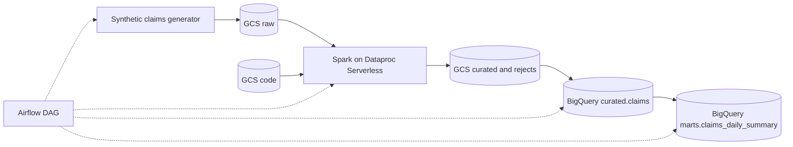

# Architecture

## Data flow

## Tasks and how each one stays idempotent

| Task | Service | Reads | Writes | Why a rerun is safe |
|---|---|---|---|---|
| `extract_synthetic_claims` | Python + GCS | nothing | `raw/claims/ds=<date>/claims.csv` | Output is deterministic for a date and the object is overwritten |
| `spark_clean_claims` | Dataproc Serverless | raw CSV | `curated/claims/ds=<date>/`, `curated/rejects/ds=<date>/` | Spark writes with `overwrite` to a date-scoped path |
| `load_curated_claims` | BigQuery load job | curated Parquet | `claims$<yyyymmdd>` | `WRITE_TRUNCATE` on a single partition replaces it |
| `build_claims_daily_summary` | BigQuery query job | `curated.claims` (one partition) | `claims_daily_summary$<yyyymmdd>` | Query result truncates the destination partition |
| `quality_checks` | BigQuery | both tables | nothing | Read-only |

The DAG has `max_active_runs=1`, retries with exponential backoff, and an `execution_timeout` on every task.

## Layers and contracts

| Layer | Location | Contract |
|---|---|---|
| Raw | `gs://<prefix>-<project>-raw` | Source CSV as received. Lifecycle-deleted after `raw_retention_days`. |
| Curated | `gs://...-curated` and `<prefix>_curated.claims` | Typed, de-duplicated, valid rows only. Partitioned by `service_date`, clustered by `diagnosis_code, provider_id`, partition filter required. |
| Rejects | `gs://...-curated/rejects/` | Invalid rows with a `reject_reason`. Kept for review. |
| Marts | `<prefix>_marts.claims_daily_summary` | Daily counts and amounts by diagnosis and status. This is what analysts read. |

### Reject reasons (first matching rule wins)

`missing_claim_id`, `conflicting_duplicate_claim_id`, `invalid_service_date`, `invalid_billed_amount`, `invalid_paid_amount`, `paid_exceeds_billed`, `invalid_status`.

Exact duplicate rows are collapsed silently. The same `claim_id` with different content is not a duplicate but a conflict, so both rows are rejected for a human to resolve.

## Security model

| Principal | Can do | Scope |
|---|---|---|
| Spark service account | Read raw and code buckets, write curated and staging buckets, run as a Dataproc worker | Per bucket, plus `roles/dataproc.worker` |
| Airflow service account | Write raw, read curated and code, submit Dataproc batches, run BigQuery jobs, edit the two datasets | Per bucket, per dataset, plus project-level job roles |
| Airflow acting as Spark | `roles/iam.serviceAccountUser` on the Spark service account only | Single service account |
| Analysts (optional) | `bigquery.dataViewer` on marts | Marts dataset only |

All buckets use uniform bucket-level access with public access prevention enforced. The Spark subnet has Private Google Access and no external IPs.

## Cost controls

- `require_partition_filter` on the curated table, plus partition and cluster keys chosen for the read pattern.
- Dataproc Serverless: no idle compute. Short lifecycle on the staging bucket and on raw.
- Everything is destroyable with `make destroy`.
- Not in code yet: a Terraform-managed billing budget. Set one in the console before deploying.

## Failure handling

| Failure | What happens | Recovery |
|---|---|---|
| Spark batch fails | Task retries with a new batch id | Fix, then clear the task |
| Load fails (for example rows outside the partition) | Task fails, partition keeps its previous contents | Fix the data or rule, clear the task |
| Quality check fails | Run fails after loading, mart already built | Investigate rejects, correct, rerun the date. Downstream consumers should depend on the DAG run, not just on table existence. |
| Rerun or backfill of a date | Same result as the first run | `airflow dags backfill` or clear the date |

## Known limitations

See "What I'd do differently at larger scale" in the README.
